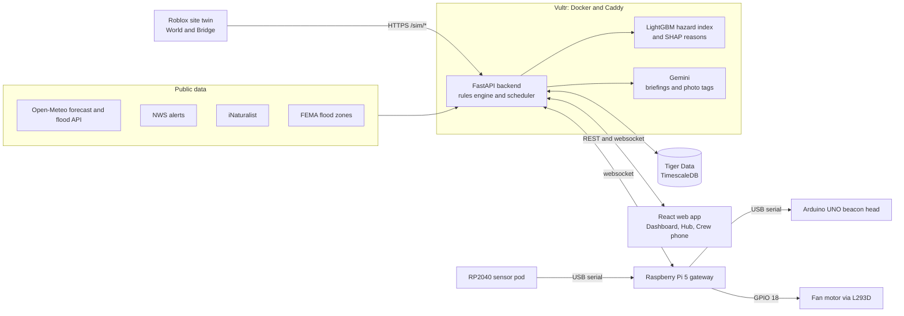
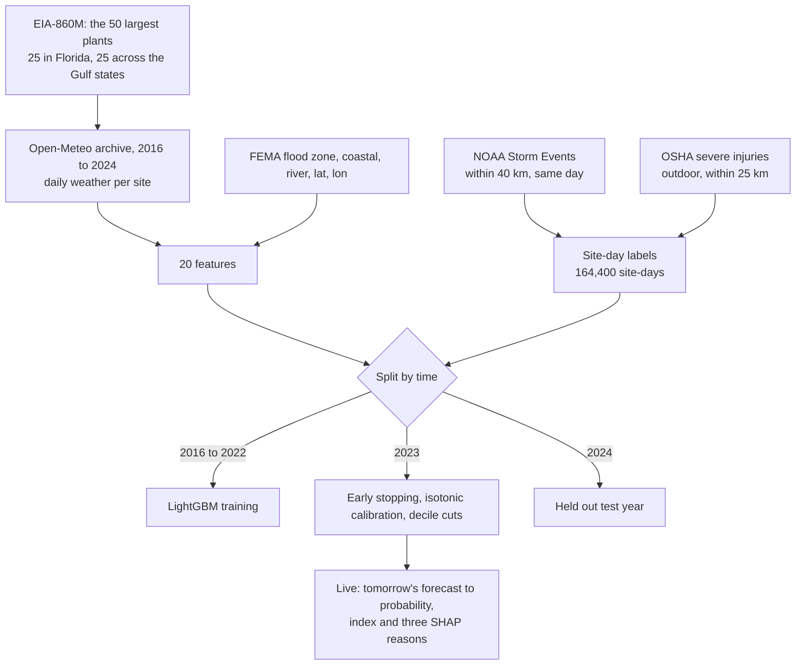
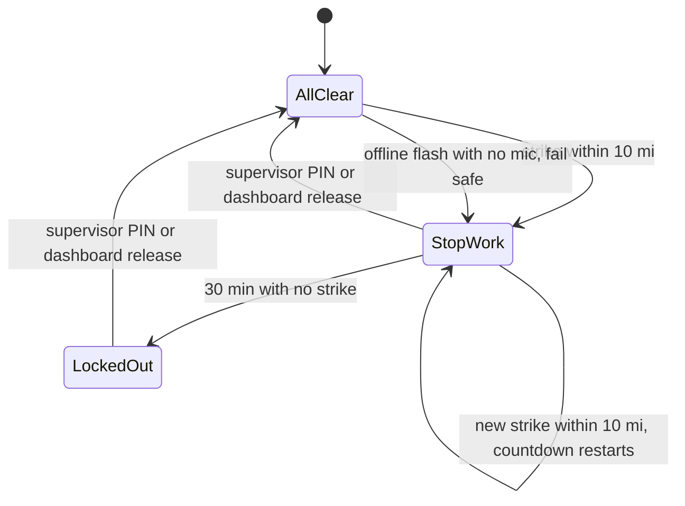
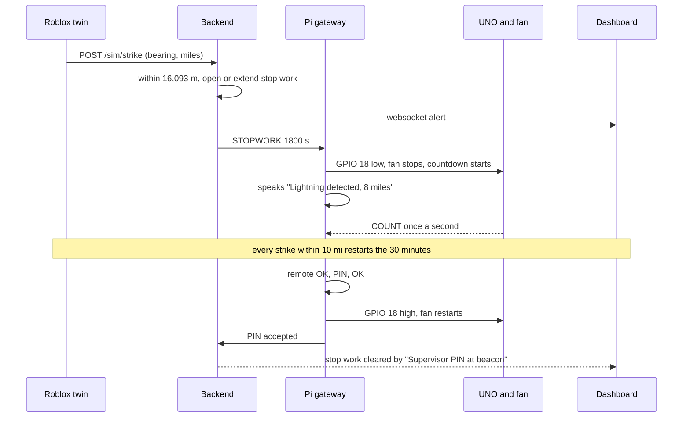

# OmniRisk

A jobsite safety platform for utility field crews, built in about 30 hours at SwampHacks XII for the PlanIT Control challenge.

Utility crews get hurt by hazards that were knowable the night before: lightning, extreme heat, flooding, soft soil. The data exists, but it lives in a dozen places and nobody turns it into a decision. OmniRisk closes that gap, from tomorrow's forecast all the way to the equipment switch.

- **Live dashboard:** https://omnirisking-it-all-at-swamphacks.us
- **API:** https://api.omnirisking-it-all-at-swamphacks.us (`/docs` lists every route; [`contracts/api.md`](contracts/api.md) is the source of truth)

## What it does

- **One risk picture per site.** The dashboard watches 50 real power plant sites across Florida and the Gulf states (25 in Florida, plus Texas, Alabama, Georgia, Louisiana and Mississippi), merging weather, heat, rain, soil moisture, river, FEMA flood zone, lightning, wind and wildlife data, ranked by a 0 to 10 machine learning hazard index with the three reasons behind it.
- **Stop work rules.** A lightning strike within 10 miles opens a 30 minute stop work countdown that restarts on every new strike, and only a supervisor PIN ends it. Heat index alerts fire at 103 °F (warning) and 115 °F (danger, with a 15 minute rest break sent to the beacon), river sites get flood warnings after heavy rain, standing water confirms a flood, and gusts raise wind alerts at 28 mph (aerial lifts down) and 40 mph (the job stops).
- **6 PM briefings.** Every evening at 6 PM in each site's local time, each site gets a next day briefing in English and Spanish, and a supervisor can run it on demand.
- **Crew phone page.** Crew check in and out, see the hazards that matter for their safety with what to do, and photograph hazards: AI tags the photo and pins it to the site map by distance and direction.
- **A physical beacon on site.** A Raspberry Pi 5, an RP2040 sensor pod and an Arduino UNO. It sees a lightning flash with its own photoresistor, cuts the equipment motor, runs the countdown, speaks the alert, shows the hazard index on a 29 LED gauge, and keeps enforcing its rules with no internet. A supervisor PIN on the IR remote restores power.
- **A Roblox digital twin.** A physically simulated storm walks in toward the site. Every strike inside 10 miles reaches the real beacon, the in world beacon mirrors the real one, and a player who walks into the work zone appears on the muster list.

## Architecture

Four pieces talk through written contracts in [`contracts/`](contracts/) (event shapes, serial lines, websocket messages, REST routes), which let four people build in parallel.

## How it works

### Backend and rules engine

FastAPI with asyncpg on Tiger Data (TimescaleDB hypertables for conditions and events). APScheduler runs the feeds (Open-Meteo forecast and NWS alerts every 15 minutes, the Open-Meteo river flood API hourly, iNaturalist every 6 hours), scores the hazard index daily at 05:00 UTC, and runs each site's briefing at 18:00 in its own time zone. Auth0 JWTs carry a supervisor role claim for releases. Websockets connect the dashboard (`/ws/site/{id}`) and the Pi (`/ws/gateway/{id}`); the Roblox Bridge posts to `/sim/*` and polls `GET /sites/{id}/device`. It runs in Docker on Vultr behind Caddy with Let's Encrypt.

**Distance to a strike** uses the haversine formula, with $R = 6371$ km:

$$d = 2R \arcsin\sqrt{\sin^2\frac{\Delta\varphi}{2} + \cos\varphi_1\cos\varphi_2\sin^2\frac{\Delta\lambda}{2}}$$

**The lightning rule.** A strike $s$ at time $t_s$ counts if $d_s \le 16{,}093$ m (10 miles). The site is clear only once 30 minutes pass with no counting strike:

$$t_{\text{clear}} = \max_{s\,:\,d_s \le 16{,}093\ \text{m}} \left(t_s + 1800\ \text{s}\right)$$

When the clock runs out the beacon stays locked out until a supervisor PIN (on the dashboard or the beacon's remote), so the equipment never restarts on its own.

**Heat index**, from the National Weather Service Rothfusz regression, with $T$ in °F and $R$ the relative humidity in percent (for $T \ge 80$ °F; below that $HI = T$):

$$\begin{aligned}HI ={}& -42.379 + 2.04901523\,T + 10.14333127\,R - 0.22475541\,TR - 6.83783\times10^{-3}\,T^2 \\ & - 5.481717\times10^{-2}\,R^2 + 1.22874\times10^{-3}\,T^2R + 8.5282\times10^{-4}\,TR^2 - 1.99\times10^{-6}\,T^2R^2\end{aligned}$$

$HI \ge 103$ °F opens a heat warning; $HI \ge 115$ °F opens heat danger and sends the beacon a 15 minute rest break.

**Floods.** River sites get a flood warning when the 24 hour rain total exceeds 50 mm or the river discharge exceeds 2.5 times its 90 day mean, $Q > 2.5\,\bar{Q}_{90}$. Standing water on the site (the beacon's probe or the twin's flood) confirms the flood, and the alert clears when the water reads 0 again.

**Wind.** Gusts of 28 mph or more raise a wind warning and 40 mph or more a wind danger. Heat, flood and wind alerts refresh while the condition lasts and expire an hour after it ends.

### Hazard index (machine learning)

Every site gets a 0 to 10 hazard index for tomorrow with the three weather reasons that pushed it up. Training code is in [`ml/`](ml/), serving code in [`backend/app/intel/`](backend/app/intel/), and the full numbers in [`ml/report/metrics.md`](ml/report/metrics.md).

**What it predicts.** The unit is a site-day: given tomorrow's weather at one of the 50 plants, how likely is a hazard that can hurt a crew. Every site and day from 2016 to 2024 is one example, $50 \times 3288 = 164{,}400$ site-days, and a site-day is positive (about 6% of them) if any of these happened that day:
- a [NOAA Storm Events](https://www.ncei.noaa.gov/stormevents/) record (heat, lightning, flood, flash flood, coastal flood, thunderstorm wind, high or strong wind, tornado, hail, tropical storm, hurricane) with coordinates within 40 km of the site,
- a zone-based Storm Events record (mostly heat) whose county matches the site's county,
- an [OSHA severe injury report](https://www.osha.gov/severeinjury) flagged outdoor (construction or electric utility NAICS, or a narrative mentioning heat, lightning, storm, flood, mud, trench, pole, line, or bucket truck) within 25 km.

**Sites and features.** Sites are the 25 largest plants in Florida and the 25 largest in GA, AL, MS, LA and TX from [EIA-860M](https://www.eia.gov/electricity/data/eia860m/) (generator rows summed per plant). The 20 features are the day's weather from [Open-Meteo](https://open-meteo.com/) (historical reanalysis for training, the forecast for scoring): max, apparent max and min temperature, max humidity, precipitation and rain, 3 and 7 day precipitation, soil moisture, gusts and wind, a heat feature, the month and the day of year as $\sin(2\pi d/365)$ and $\cos(2\pi d/365)$, plus fixed site facts ([FEMA flood zone](https://www.fema.gov/flood-maps/national-flood-hazard-layer), coastal, river, latitude, longitude).

**Model.** Gradient boosted trees (LightGBM). Each round adds a tree to the log-odds score,

$$F_m(x) = F_{m-1}(x) + \eta\, h_m(x), \qquad \eta = 0.05,$$

with 31 leaf trees, at least 50 samples per leaf and 80% of features per tree. Positives are rare, so they are weighted by $w = N_{\text{neg}}/N_{\text{pos}}$ in the log loss:

$$\mathcal{L} = -\sum_i w_i\left[y_i \log p_i + (1-y_i)\log(1-p_i)\right], \qquad p_i = \sigma(F(x_i))$$

Training stopped early on the 2023 validation year's average precision, at 182 trees.

**How it is tested.** Split by time, never at random: train 2016 to 2022, validate and calibrate 2023, test once on 2024. A random split would let the same storm leak into training and test through neighboring sites and days. Every metric is also reported for the rule a supervisor would write by hand (heat index at least 103 °F, or 3 day rain at least 75 mm, or gusts at least 60 km/h).

| 2024 test year (18,300 site-days, 5.8% positive) | Model (LightGBM, isotonic calibration) | Baseline rule |
|---|---|---|
| PR AUC (average precision) | **0.246** | 0.084 |
| ROC AUC | **0.817** | 0.594 |
| Brier score (lower is better) | **0.049** | 0.136 |
| Precision / recall | 0.211 at 50% recall | 0.149 at 29% recall |

Average precision is $AP = \sum_n (R_n - R_{n-1})\,P_n$ over the precision recall curve, and the Brier score is $\frac{1}{N}\sum_i (\hat{p}_i - y_i)^2$. A random guess scores an average precision of about 0.058, the positive rate, so the model is about 4 times better than chance and 3 times better than the rule. The rule catches 29% of hazard days and is right 15% of the time it fires; set to catch half of them, the model is right 21% of the time.

  

**Calibration.** The class weights distort the raw scores, so an isotonic regression fit on 2023 maps them back to probabilities. It finds the non-decreasing function $g$ that minimizes

$$\sum_i \left(y_i - g(s_i)\right)^2,$$

stored as points in `schema.json` and applied with linear interpolation. Predicted probabilities track what actually happened up to about 0.3, which is where nearly every site-day falls; above 0.5 there are only a handful of days per bin and the model is overconfident.

**The 0 to 10 index.** The calibrated probability $\hat{p}$ is placed among the 2023 validation deciles $q_1 < \dots < q_9$:

$$I(x) = \sum_{k=1}^{9} \mathbf{1}\left[\hat{p}(x) > q_k\right]$$

so a 7 means tomorrow looks riskier than 70% of the site-days the model was validated on.

**The three reasons.** SHAP (TreeExplainer) splits each prediction into feature contributions, the Shapley values

$$\phi_j = \sum_{S \subseteq F \setminus \{j\}} \frac{|S|!\,(|F|-|S|-1)!}{|F|!}\left[f(S \cup \{j\}) - f(S)\right], \qquad \sum_j \phi_j = f(x) - \mathbb{E}[f(X)].$$

Same-signal features are summed (heat index, apparent max and max temperature; rain and precipitation; gusts and wind), and the three largest weather contributions are shown as plain values ("3 day rain 111 mm", "Gusts 49 km/h"). Location features stay in the model but are never shown as a reason.

**What it is not.** The label is at county and day resolution, so the model cannot know whether a particular crew was exposed; it is a ranking tool for deciding where to look first, not a forecast of injury. Zone-based heat events are matched to counties by name and are undercounted. OSHA reports are placed by zip code, which can be several kilometers off, and the outdoor flag is a keyword match. Location ranks high in the SHAP chart, so part of what the model learned is which sites have historically been riskier, not only which weather is. The heat feature is the day's maximum apparent temperature, not the NWS heat index formula, because the daily data cannot pair the afternoon high with afternoon humidity. Training weather is reanalysis and scoring weather is a forecast, so tomorrow's index inherits the forecast's error. The baseline rule is in every table so you can see how much the model adds.

### Gemini

The 6 PM briefings (English and Spanish), the one sentence explanation of each index, and hazard photo tagging use Gemini with JSON response schemas. Every number in generated text is checked against the numbers in its input. With $N(\cdot)$ the set of numbers in a text, a briefing is accepted only if

$$N(\text{output}) \subseteq N(\text{input}),$$

otherwise it retries once, then falls back to a template built from the input alone, so a briefing can never state a number that is not in the data. Calls go through a small queue that retries rate limits and server errors.

### The physical beacon

Code is in [`firmware/`](firmware/): [`pod/`](firmware/pod/), [`controlbox/`](firmware/controlbox/) and [`gateway/`](firmware/gateway/); the wiring is in [`docs/hardware-guide.md`](docs/hardware-guide.md) and the serial lines in [`contracts/serial.md`](contracts/serial.md).

**Sensor pod (RP2040-Zero, MicroPython).** Core 1 samples the photoresistor at 5 kHz. At boot it measures the resting light, mean $\mu$ and standard deviation $\sigma$, and sets the flash threshold

$$\theta = \mu + \max(6\sigma,\ 1500)$$

in 16 bit ADC counts. A flash needs two samples in a row above $\theta$, with a 300 ms refractory period, and the mean tracks slow light changes so a passing shadow is not lightning. Core 0 reads the LD2410B mmWave radar (presence and distance), the DHT11, the water probe and the tilt switch, decodes the IR remote (NEC protocol on a pin interrupt), and streams one line every 100 ms.

**Flash to bang.** When thunder is heard (a microphone page on the twin laptop, or a USB mic on the Pi), the distance is

$$d = c\,\Delta t, \qquad c \approx 343\ \text{m/s},$$

so 10 miles is a gap of about 46.9 s, roughly 4.69 s per mile. Pairs must fall between 0.3 and 60 s. Offline with no microphone, a flash alone fails safe to a stop work with the distance unknown.

**Beacon head (Arduino UNO).** It drives the LCD1602 text screen, the 4 digit countdown (a 74HC595 shift register, one digit lit every 2 ms) and a 29 LED WS2812B strip. The strip is the gauge: a white bar climbs from LED10 toward LED1 with the hazard index, and LED25 to LED29 show the status color (green, yellow, red, strobing red in a stop work). The countdown on the display, the LCD and the dashboard all come from the UNO's own once a second echo, so they never disagree. The serial link runs at 9600 baud on purpose: one byte takes longer than the strip update's 1 ms interrupt pause, so no command is ever lost.

**Gateway (Raspberry Pi 5, Python asyncio).** It runs the local rules, holds the equipment interlock on GPIO 18 through an L293D driver (low stops the motor, and the pin is held low if the program stops or crashes), speaks with Piper text to speech offline in English and Spanish, and handles the remote: crew numbers check in, OK plus the 4 digit PIN plus OK releases a stop work. Offline it keeps enforcing everything, queues its events and replays them in order with their original timestamps when it reconnects. A stop work survives a reboot, and a release made on the dashboard while the beacon was offline is applied when it comes back.

### The Roblox digital twin

Code is in [`sim/`](sim/): the World in `sim/src/World`, the Bridge to the backend in `sim/src/Bridge`, and the place in `sim/place/PlanITSwamp.rbxl`.

The twin's lightning is simulated physics, not a script. A storm cell starts about 20 miles out and moves toward the site,

$$\mathbf{p}(t) = \mathbf{p}_0 + \mathbf{v}\,t,$$

and its cloud to ground flash rate rises and falls over its life $T$:

$$\lambda(t) = \lambda_{\text{peak}}\sin\left(\frac{\pi t}{T}\right)$$

Strike times are a non-homogeneous Poisson process, drawn by thinning: candidates arrive every $\Delta t = -\ln U / \lambda_{\max}$ and are kept with probability $\lambda(t)/\lambda_{\max}$. 95% of strikes land at a Rayleigh distributed offset from the cell's core,

$$f(r) = \frac{r}{\sigma^2}\, e^{-r^2/2\sigma^2}, \qquad \sigma = 1.5\ \text{mi},$$

and 5% are "bolts from the blue", 5 to 10 miles ahead of the storm. Each strike's distance and bearing to the site are computed from its position, never typed in. Thunder arrives after $d/c(T)$ with the speed of sound set by the scenario's air temperature,

$$c(T) = 331.3 + 0.606\,T\ \text{m/s},$$

its loudness falls as $1/d$ and fades to silence between 10 and 15 miles, and the screen flash falls as $1/d^2$. The random number generator is seeded, so a scenario plays out the same way every time and the Lune test harness can verify the exact strikes Studio fires.

The twin also drives weather, floods (the water depth reaches the beacon as if its own probe were wet), wind, heat and an alligator sighting, and players inside the work zone appear on the muster list.

### Web

A React and TypeScript app (Vite, Tailwind): the Dashboard (map, ranked site list, status of every data feed and the beacon), the Hub for each site (the factor web from categories down to live readings with trends and forecasts, the hazard index and its reasons, muster, the 48 hour conditions chart, hazard reports, briefings, and the compliance log of every stop work), a phone first crew page (sign in, check in, condition cards with what to do, hazard photos, English and Spanish), and Auth0 sign in with a supervisor role for releases.

## Repository layout

| Folder | What | Built by |
|---|---|---|
| `backend/app/core` | database, fetchers, rules, scheduler, websockets, auth, gateway endpoint, sim ingest | Viet, Chris |
| `backend/app/intel` | hazard index scoring, briefings, Gemini photo tagging | Chris |
| `ml` | training pipeline and report | Chris |
| `web` | dashboard, Hub, crew phone page | Cam |
| `sim/src/World`, `sim/place` | Roblox place, scenarios, lightning, zone, beacon visuals, scene | Slavik, storm model by Viet |
| `sim/src/Bridge` | Luau HTTP bridge to the backend | Viet |
| `firmware/gateway`, `firmware/pod`, `firmware/controlbox` | Pi gateway, sensor pod, beacon head | Chris (software), Slavik (hardware build) |
| `contracts` | the interfaces every piece speaks | Chris |
| `deploy` | Docker Compose, Caddy, server notes | Chris |
| `docs` | the build guides | everyone |

## Running it

- **Backend locally:** fill `.env` from `.env.example` ([`contracts/env.md`](contracts/env.md) says who sets what), then `scripts/dev.sh backend`. The schema creates itself on first boot and `data/sites.csv` is loaded on every boot. `python -m app.core.seed` (from `backend/`) adds the demo crew and two sample reports.
- **Backend in Docker:** `docker compose -f deploy/docker-compose.yml up -d --build backend web`.
- **End to end test:** with the real Pi offline, `python -m app.core.e2e <base_url>` from `backend/` strikes the beacon site twice, checks the fake gateway gets STOPWORK and the countdown moved, then clears it with the PIN.
- **Beacon:** the Pi setup, the on device tests and a laptop simulator of the pod and UNO (`devsim.py`) are in [`firmware/gateway/README.md`](firmware/gateway/README.md); flashing the pod and the UNO is in [`firmware/pod/README.md`](firmware/pod/README.md) and [`firmware/controlbox/README.md`](firmware/controlbox/README.md).
- **Roblox:** open `sim/place/PlanITSwamp.rbxl` in Studio, paste the sim token into the Bridge's attributes, enable HTTP requests, and press Play. `lune run sim/test/harness.luau sim/place/PlanITSwamp.rbxl` runs every scenario outside Studio. See [`sim/CLAUDE.md`](sim/CLAUDE.md).
- **Training:** [`ml/`](ml/) downloads the data, builds the labels and features, and trains (`download.py`, `labels.py`, `weather.py`, `features.py`, `train.py`); it writes the model into `backend/app/intel/model/` and the report into `ml/report/`.

## Branches

`main` is demo ready and only receives merges from `dev`. `dev` is integration. Work on `feature/<area>-<thing>` off `dev`, merge back often. See [CLAUDE.md](CLAUDE.md).

## Challenges

- Building a hazard label from county and zip code level records without leaking the same storm into both training and test data.
- Keeping the beacon fully functional offline, then syncing its events once it reconnects, including a release made on the dashboard while the beacon was offline.
- Getting Roblox, the backend and physical sensors to agree in real time, and making the twin's lightning physically correct instead of scripted.
- Real hardware: a DC motor's electrical kick could garble the LCD mid write (the UNO now resyncs and redraws it every 5 seconds), a power bank sagged the Pi's 5 V under load and browned out the speaker (it runs on wall power), and the only spare servo was a continuous rotation type that cannot hold a position, so the LED strip became the gauge.

## What's next

More sites and regions, real lightning network feeds, document ingestion (site PDFs and inspection records feeding each site's hazard history), wind and wildlife warnings on the beacon itself, a published twin that anyone can join from a phone, a microphone on the beacon so flash to bang works fully offline, pilots with utility crews, and a hardened beacon enclosure.
