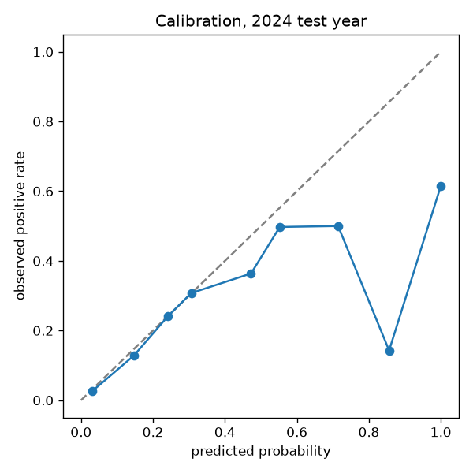
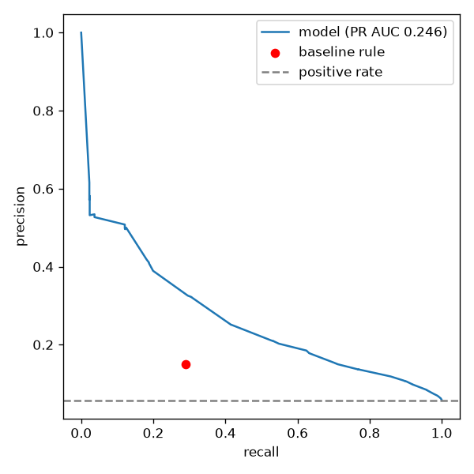
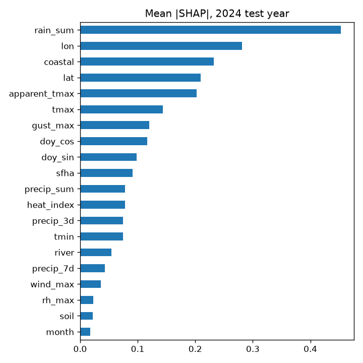

# Hazard index metrics

Test year 2024, never seen in training (train 2016 to 2022, validate and calibrate 2023). 50 sites,
18,300 test site-days, positive rate 5.8%. Model is LightGBM (182 trees, early stopped on
2023 PR AUC) with isotonic calibration fit on 2023. Baseline is the hand rule: heat index >= 103 F, or 3 day rain >= 75 mm,
or gusts >= 60 km/h. The rule is yes or no, so its precision and recall are at its one operating point.

| Metric | Model | Baseline rule |
|---|---|---|
| PR AUC | 0.246 | 0.084 |
| ROC AUC | 0.817 | 0.594 |
| Brier | 0.049 | 0.136 |
| Precision at 50% recall | 0.211 | 0.149 |
| Recall | 0.527 | 0.289 |

  

Top features by mean |SHAP|: rain_sum, lon, coastal, lat, apparent_tmax.

The 0 to 10 index is the number of 2023 validation deciles a site's calibrated probability exceeds, so a 7 means
the day is riskier than 70% of the site-days the model was validated on.
